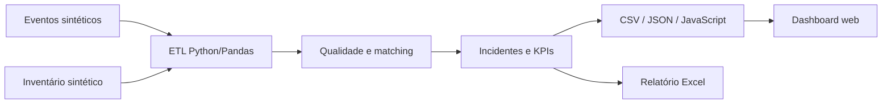

# CoreOps NOC Dashboard

[](pyproject.toml)
[](src/coreops_demo/pipeline.py)
[](sql/)
[](tests/)
[](SECURITY.md)

Portfólio de Dados e Business Intelligence que transforma eventos técnicos de
monitoramento em incidentes enriquecidos, indicadores operacionais e uma dashboard
voltada à tomada de decisão em um NOC.

O repositório não é apenas uma interface: o dataset exibido pela dashboard é gerado
por um pipeline reproduzível em **Python e Pandas**, com normalização, filtro de
ruído, deduplicação, matching em camadas, cálculo de KPIs e artefatos auditáveis.

> **Privacidade:** todos os nomes, circuitos, endereços IP, eventos, protocolos e
> indicadores são fictícios. Não existem credenciais, consultas internas, planilhas
> corporativas ou dados de produção neste repositório.

## O que este projeto comprova

- ingestão e validação de múltiplas fontes CSV;
- limpeza, normalização e deduplicação com Pandas;
- enriquecimento por `host + interface` e fallback por circuito;
- construção de incidentes por pareamento de `PROBLEM` e `RECOVERY`;
- métricas de SLA, MTTR, disponibilidade e qualidade do matching;
- modelo relacional, views analíticas e índices PostgreSQL;
- geração automática do contrato JSON/JavaScript consumido pela dashboard;
- relatório Excel semanal com backup antes da gravação;
- testes unitários e validação contínua no GitHub Actions.

## Fluxo de dados



A explicação completa está em [Arquitetura](docs/ARCHITECTURE.md) e os campos estão
documentados no [Dicionário de dados](docs/DATA_DICTIONARY.md).

## Executar localmente

```bash
python -m venv .venv
python -m pip install -e ".[dev]"
python -m coreops_demo.pipeline
pytest -q
python -m coreops_demo.weekly_report
python -m http.server 8000
```

Depois, abra `http://localhost:8000`. Os arquivos gerados ficam em
`data/processed/` e o relatório de demonstração em `output/`.

## Camadas do repositório

```text
.
|-- data/
|   |-- raw/                 # eventos e inventário sintéticos
|   `-- processed/           # artefatos reproduzíveis do ETL
|-- src/coreops_demo/
|   |-- pipeline.py          # ingestão, qualidade, matching e KPIs
|   `-- weekly_report.py     # automação de relatório Excel
|-- sql/                     # schema, índices e views PostgreSQL
|-- tests/                   # testes de regressão e qualidade
|-- docs/                    # arquitetura e dicionário de dados
|-- index.html               # dashboard demonstrativa
|-- app.js
`-- styles.css
```

## Dashboard demonstrativa

A interface permite filtrar incidentes, acompanhar SLA, identificar unidades
isoladas, analisar operadoras e consultar a visão de NOC Wall. Alterações de
tratativa ficam somente no `localStorage` do navegador.

Principais decisões de produto:

- **ação primeiro:** a próxima ação aparece antes do detalhe técnico;
- **densidade controlada:** leitura rápida de uma fila operacional extensa;
- **cores semânticas:** criticidade, risco e estabilidade consistentes;
- **passagem de turno:** responsável, status e histórico permanecem juntos;
- **rastreabilidade:** o dataset informa quando e como foi gerado.

## Segurança e autoria

Consulte [SECURITY.md](SECURITY.md) antes de reutilizar qualquer parte. Projeto de
portfólio de **Celso Kaique**, desenvolvido como demonstração independente de uma
arquitetura de dados aplicada a operações.
