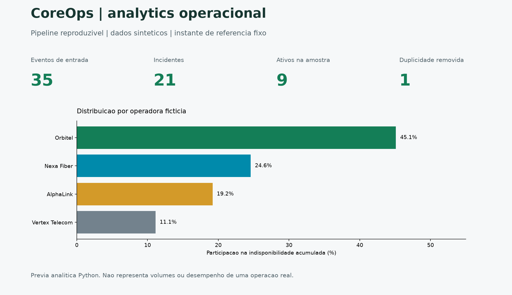
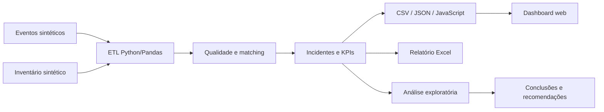

# CoreOps NOC Dashboard

[Baixar Excel sintetico de exemplo](docs/examples/coreops_weekly_demo.xlsx) · [Historico de mudancas](CHANGELOG.md)



**Problema:** transformar eventos de monitoramento em uma fila priorizavel e indicadores auditaveis.

- 35 eventos de exemplo produzem 21 incidentes; ruido e duplicidade ficam registrados.
- Interface local, Excel e estudo analitico partem do mesmo pipeline reproduzivel.
- Nenhum dado operacional ou credencial e necessario para executar.

[Demonstracao web](https://celsokaiquesil.github.io/coreops-noc-dashboard/) ·
[Escopo publico versus privado](docs/DEMO_SCOPE.md) ·
[Evidencias de resultado](docs/IMPACT_EVIDENCE.md) ·
[Caso Central de Relatorios](docs/REPORT_CENTER_CASE_STUDY.md)

A imagem acima e uma previa analitica gerada em Python, nao captura de producao.

[](pyproject.toml)
[](src/coreops_demo/pipeline.py)
[](analysis/operational_analysis.md)
[](sql/)
[](tests/)
[](SECURITY.md)

Portfólio de Dados e Business Intelligence que transforma eventos técnicos de
monitoramento em incidentes enriquecidos, indicadores operacionais e uma dashboard
voltada à tomada de decisão em um NOC.

O repositório não é apenas uma interface: o dataset exibido pela dashboard é gerado
por um pipeline reproduzível em **Python e Pandas**, com normalização, filtro de
ruído, deduplicação, matching em camadas, cálculo de KPIs e artefatos auditáveis.
O projeto também inclui um **estudo exploratório orientado a negócio**, com
estatística descritiva, comparações, tendências, correlações e recomendações.
O portfólio documenta ainda três automações aplicadas ao trabalho: relatórios
Zabbix, indicadores de Service Desk e atualização agendada de planilhas a partir
do FortiView.

> **Privacidade:** todos os nomes, circuitos, endereços IP, eventos, protocolos e
> indicadores são fictícios. Não existem credenciais, consultas internas, planilhas
> corporativas ou dados de produção neste repositório.

## O que este projeto comprova

- ingestão e validação de múltiplas fontes CSV;
- limpeza, normalização e deduplicação com Pandas;
- enriquecimento por `host + interface` e fallback por circuito;
- construção de incidentes por pareamento de `PROBLEM` e `RECOVERY`;
- métricas de SLA, MTTR, disponibilidade e qualidade do matching;
- modelo relacional, views analíticas e índices PostgreSQL;
- geração automática do contrato JSON/JavaScript consumido pela dashboard;
- relatório Excel semanal com backup antes da gravação;
- estudo exploratório com média, mediana, percentis, correlações e recomendações;
- gráficos SVG e tabelas analíticas gerados por código;
- testes unitários e validação contínua no GitHub Actions.

## Automações aplicadas

Além da demonstração reproduzível deste repositório, o portfólio apresenta estudos
de caso de automações que desenvolvi em contexto profissional:

| Automação | Entrega | Competências demonstradas |
|---|---|---|
| [**Pipeline de relatórios Zabbix**](https://github.com/CelsoKaiqueSil/zabbix-reporting-pipeline) | Coleta somente leitura, processamento em lotes, análise de CPU, memória, tráfego e picos, com relatórios Excel auditáveis | APIs, Python, ETL, séries temporais e qualidade de dados |
| [**Service Desk Analytics**](https://github.com/CelsoKaiqueSil/service-desk-analytics) | Consolidação de chamados, backlog, SLA e tempos de atendimento, incluindo média, mediana e P90 | BI, indicadores, reconciliação e comunicação executiva |
| [**FortiView para Excel/SharePoint**](https://github.com/CelsoKaiqueSil/fortiview-excel-automation) | Coleta agendada de tráfego, backup e atualização padronizada de planilhas | Automação de processos, Excel, agendamento e integração |

Cada automação possui agora um repositório independente, com dados sintéticos,
código executável, testes automatizados e integração contínua. As arquiteturas,
decisões e resultados também estão reunidos em
[Portfólio de automações](docs/AUTOMATIONS_PORTFOLIO.md). Por segurança e
confidencialidade, o repositório não publica scripts de produção, credenciais,
endereços internos ou dados de clientes.

## Fluxo de dados



A explicação completa está em [Arquitetura](docs/ARCHITECTURE.md) e os campos estão
documentados no [Dicionário de dados](docs/DATA_DICTIONARY.md).

## Executar localmente

```bash
python -m venv .venv
source .venv/bin/activate  # Linux/macOS
python -m pip install -e ".[dev]"
python -m coreops_demo.pipeline
python -m coreops_demo.analysis
pytest -q
python -m coreops_demo.weekly_report
python -m http.server 8000
```

Depois, abra `http://localhost:8000`. Os arquivos gerados ficam em
`data/processed/` e o relatório de demonstração em `output/`.

No Windows PowerShell, use `.\.venv\Scripts\Activate.ps1` em lugar de `source`.
Sem ativar o ambiente, execute `.\.venv\Scripts\python.exe` em lugar de `python`
e use `python -m pytest` para os testes. Nao altere politicas globais do sistema.

Resultado esperado: `quality_summary.json` informa 35 entradas, 1 ruido e
1 duplicidade; `output/coreops_weekly_demo.xlsx` tem Resumo, Incidentes e KPIs por
operadora. `python scripts/validate_exports.py` confere os arquivos gerados.
`python scripts/preview.py` regenera a imagem. As metas de SLA sao apenas didaticas.

## Camadas do repositório

```text
.
|-- data/
|   |-- raw/                 # eventos e inventário sintéticos
|   `-- processed/           # artefatos reproduzíveis do ETL
|-- analysis/                # estudo, tabelas e gráficos reproduzíveis
|-- src/coreops_demo/
|   |-- analysis.py          # EDA, estatística e recomendações
|   |-- pipeline.py          # ingestão, qualidade, matching e KPIs
|   `-- weekly_report.py     # automação de relatório Excel
|-- sql/                     # schema, índices e views PostgreSQL
|-- tests/                   # testes de regressão e qualidade
|-- docs/                    # arquitetura, dicionário e estudos de caso
|-- index.html               # dashboard demonstrativa
|-- app.js
`-- styles.css
```

## Dashboard demonstrativa

A interface permite filtrar incidentes, acompanhar SLA, identificar unidades
isoladas, analisar operadoras e consultar a visão de NOC Wall. Alterações de
tratativa ficam somente no `localStorage` do navegador.

Principais decisões de produto:

- **ação primeiro:** a próxima ação aparece antes do detalhe técnico;
- **densidade controlada:** leitura rápida de uma fila operacional extensa;
- **cores semânticas:** criticidade, risco e estabilidade consistentes;
- **passagem de turno:** responsável, status e histórico permanecem juntos;
- **rastreabilidade:** o dataset informa quando e como foi gerado.

## Estudo analítico

O estudo [Indisponibilidade e desempenho operacional](analysis/operational_analysis.md)
parte de cinco perguntas de negócio e entrega estatística descritiva, análise por
operadora e regional, tendência mensal, correlações exploratórias, conclusões,
recomendações e limitações. Todos os CSVs, o Markdown e os gráficos SVG são
regenerados pelo comando `python -m coreops_demo.analysis`.

## Segurança e autoria

Consulte [SECURITY.md](SECURITY.md) antes de reutilizar qualquer parte. Projeto de
portfólio de **Celso Kaique**, desenvolvido como demonstração independente de uma
arquitetura de dados aplicada a operações.
