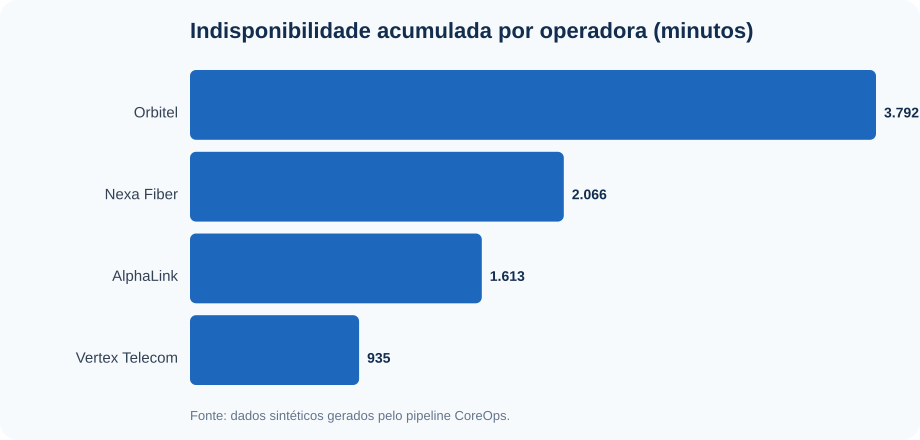
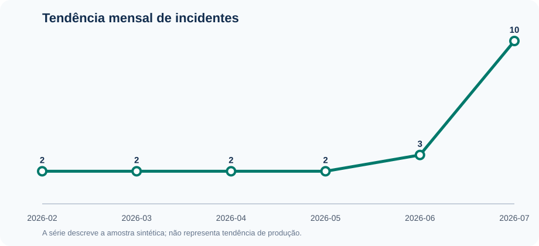

# Estudo analítico: indisponibilidade e desempenho operacional

Este estudo transforma os incidentes sintéticos produzidos pelo pipeline em uma
análise exploratória orientada a decisões. O objetivo é demonstrar estatística
descritiva, segmentação, análise temporal, correlação e comunicação de recomendações.

> **Escopo:** a base é pequena, determinística e 100% sintética. As conclusões
> demonstram o método analítico e não descrevem a operação de nenhuma empresa.

## Perguntas de negócio

1. Quais operadoras concentram mais indisponibilidade e incidentes?
2. Quais regionais merecem priorização por duração acumulada?
3. Como a duração se distribui e qual limiar separa os casos mais longos?
4. Há associação linear entre severidade, capacidade do link e duração?
5. Como o volume varia ao longo dos meses disponíveis?

## Método

- validação de tipos, campos obrigatórios e valores booleanos;
- estatística descritiva com média, mediana e percentis 75 e 90;
- agregações por operadora, regional e mês;
- correlação de Pearson usada apenas como análise exploratória;
- geração automática de CSV, Markdown e gráficos SVG versionáveis.

## Visão geral

| Métrica | Valor | Unidade |
| --- | --- | --- |
| Incidentes | 21 | contagem |
| Incidentes ativos | 9 | contagem |
| Participação de ativos | 42,86 | % |
| Duração média | 400,29 | minutos |
| Duração mediana | 145 | minutos |
| Percentil 75 da duração | 300 | minutos |
| Percentil 90 da duração | 1080 | minutos |
| Maior duração | 3072 | minutos |
| Indisponibilidade acumulada | 140,10 | horas |
| Severidade média | 3,86 | escala 0-5 |

## Operadoras



| Operadora | Incidentes | Ativos | Indisp. (min) | Média (min) | P90 (min) | Participação (%) |
| --- | --- | --- | --- | --- | --- | --- |
| Orbitel | 6 | 3 | 3792 | 632 | 1686 | 45,11 |
| Nexa Fiber | 4 | 3 | 2066 | 516,50 | 1141,20 | 24,58 |
| AlphaLink | 7 | 2 | 1613 | 230,43 | 540 | 19,19 |
| Vertex Telecom | 4 | 1 | 935 | 233,75 | 310,50 | 11,12 |

## Regionais

| Regional | Incidentes | Indisp. (min) | Média (min) | Participação (%) |
| --- | --- | --- | --- | --- |
| Regional Sudeste D | 3 | 3172 | 1057,33 | 37,73 |
| Regional Nordeste | 2 | 1716 | 858 | 20,41 |
| Regional Centro-Oeste | 4 | 1555 | 388,75 | 18,50 |
| Regional Sudeste C | 3 | 795 | 265 | 9,46 |
| Regional Sul | 3 | 510 | 170 | 6,07 |
| Regional Sudeste B | 3 | 435 | 145 | 5,17 |
| Regional Sudeste A | 3 | 223 | 74,33 | 2,65 |

## Tendência mensal



| Mês | Incidentes | Ativos | Indisp. (min) | Média (min) |
| --- | --- | --- | --- | --- |
| 2026-02 | 2 | 0 | 200 | 100 |
| 2026-03 | 2 | 0 | 235 | 117,50 |
| 2026-04 | 2 | 0 | 275 | 137,50 |
| 2026-05 | 2 | 0 | 230 | 115 |
| 2026-06 | 3 | 0 | 410 | 136,67 |
| 2026-07 | 10 | 9 | 7056 | 705,60 |

## Correlações exploratórias

| Variável X | Variável Y | Correlação de Pearson |
| --- | --- | --- |
| severity | duration_minutes | 0,56 |
| speed_mbps | duration_minutes | -0,18 |

A correlação entre severidade e duração foi **0,560**,
classificada nesta amostra como **moderada e positiva**.
Correlação não implica causalidade e a amostra não é adequada para inferência estatística.

## Conclusões

- **Orbitel** concentrou a maior indisponibilidade acumulada:
  **3792 minutos**
  (**45,11%** da amostra).
- **Regional Sudeste D** foi a regional com maior duração acumulada,
  somando **3172 minutos**.
- A duração mediana foi de **145 minutos** e o
  percentil 90 foi de **1080 minutos**;
  os casos acima desse patamar formam a cauda mais crítica da amostra.
- **9 de 21 incidentes** estavam ativos
  no instante de referência do pipeline.

## Recomendações

1. Priorizar a revisão dos incidentes da operadora **Orbitel** e
   segmentar por circuito e unidade antes de definir uma ação corretiva.
2. Criar um alerta analítico para casos acima do percentil 75
   (**300 minutos**) e uma fila crítica
   para ocorrências acima do percentil 90.
3. Acompanhar mensalmente volume, indisponibilidade acumulada e duração mediana;
   usar a mediana junto da média reduz a distorção causada por incidentes extremos.
4. Manter as taxas de matching e duplicidade como critérios de qualidade antes de
   comparar operadoras ou regionais.
5. Em uma base real maior, acrescentar intervalo de confiança, sazonalidade,
   recorrência por circuito e testes de hipótese antes de generalizar decisões.

## Limitações

- amostra propositalmente pequena e sintética;
- recorte temporal fixo para garantir reprodutibilidade;
- ausência de variáveis externas como manutenção, clima e causa raiz;
- associações observadas não demonstram causalidade.

## Reproduzir

```bash
python -m coreops_demo.pipeline
python -m coreops_demo.analysis
```

Os arquivos tabulares desta análise ficam nesta pasta e podem ser auditados ou
reutilizados em Power BI, Excel e notebooks.
