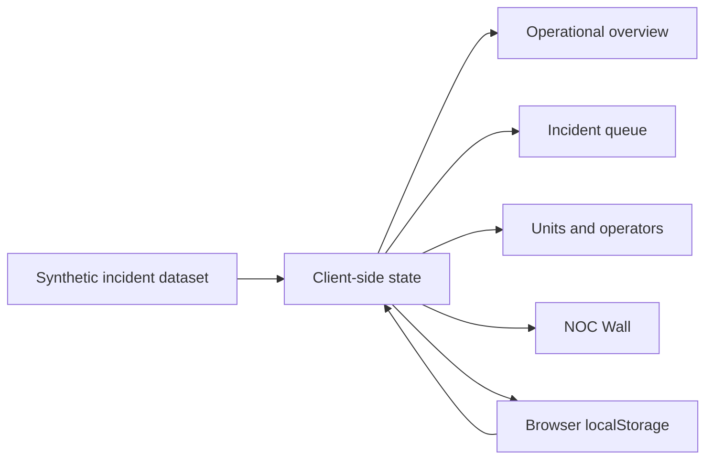

# Demonstration architecture

The public edition is intentionally frontend-only. It reproduces the operational
workflow without exposing the production integration layer.

## Production concepts represented

- Event enrichment and operational prioritization.
- Incident ownership, treatment status, SLA, and activity history.
- Unit isolation and multi-link impact.
- Operator and regional aggregation.
- A TV-oriented NOC Wall with a reduced information hierarchy.

## Deliberately excluded

- Authentication and role management.
- PostgreSQL schema and queries.
- Zabbix API integration and matching logic.
- Deployment scripts and server addresses.
- Real spreadsheets, contacts, incidents, and inventory.

