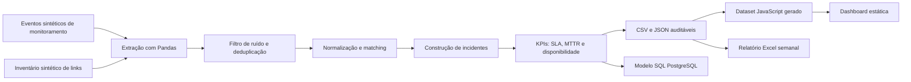

# Arquitetura da demonstração pública

Esta edição reproduz o fluxo técnico do CoreOps com dados totalmente sintéticos.
Ela não acessa Zabbix, firewalls, planilhas corporativas ou bancos de produção.

## Decisões de engenharia

- **Normalização determinística:** remoção de acentos, espaços e pontuação para
  criar chaves comparáveis de host, interface e circuito.
- **Matching em camadas:** primeiro `host + interface`; quando a interface diverge,
  o pipeline usa o identificador do circuito como fallback auditável.
- **Deduplicação:** eventos equivalentes do mesmo host, interface, estado e minuto
  recebem uma impressão digital e são consolidados.
- **Pareamento de eventos:** cada `PROBLEM` é associado à recuperação subsequente;
  eventos sem recuperação permanecem ativos na dashboard.
- **Qualidade observável:** o pipeline exporta contagens de ruído descartado,
  duplicidades removidas e método usado em cada match.
- **Reprodutibilidade:** a data de referência é configurável para que testes e
  artefatos gerados sejam determinísticos.

## Fronteira entre demonstração e produção

| Demonstração pública | Conceito operacional representado |
| --- | --- |
| CSV sintético | API de monitoramento e bases operacionais |
| Pandas local | Rotinas de ingestão e enriquecimento |
| Scripts SQL versionados | PostgreSQL e views analíticas |
| Arquivos JSON/JS | API consumida pela dashboard |
| Relatório Excel de exemplo | Automação semanal de relatórios |
| Testes unitários | Validações de qualidade e regressão |

Credenciais, endereços de servidores, consultas internas, nomes reais e código de
implantação permanecem deliberadamente fora do repositório.

