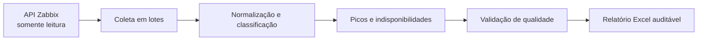

# Portfólio de automações

Esta página reúne estudos de caso de automações desenvolvidas por **Celso Kaique**
em contexto profissional. O objetivo é apresentar raciocínio de engenharia,
qualidade de dados e impacto operacional sem expor clientes, infraestrutura,
credenciais ou código proprietário.

## 1. Pipeline de relatórios Zabbix

### Problema

Métricas de monitoramento estavam distribuídas entre diferentes gráficos, hosts e
períodos. A consolidação manual dificultava comparar clientes, identificar picos e
validar a ausência de dados.

### Solução

- integração somente leitura com a API do Zabbix;
- processamento em lotes de tendências, histórico, eventos e problemas;
- classificação de métricas de CPU, memória e tráfego;
- identificação do valor máximo, primeira data/hora do pico e recorrência;
- deduplicação de indisponibilidades por identificador de evento;
- geração automatizada de planilhas com Resumo, Picos, Controle e detalhamento;
- sinalização explícita de períodos sem dados, sem substituir ausência por zero.

### Resultado

O pipeline transformou uma coleta fragmentada em um processo reproduzível,
auditável e adequado à análise gerencial, reduzindo trabalho manual e erros de
classificação.

### Tecnologias

Python, API REST/JSON-RPC, Pandas, Excel, processamento em lotes e validação de
qualidade.

## 2. Service Desk Analytics

### Problema

Indicadores de atendimento precisavam ser consolidados sem misturar definições de
chamados abertos, resolvidos, encerrados, backlog e cumprimento de SLA.

### Solução

- coleta e reconciliação de registros do Service Desk;
- indicadores de entrada, resolução, encerramento e estoque de chamados;
- cálculo de tempos de primeira resposta e solução;
- uso de média, mediana e percentil 90 para evitar conclusões baseadas apenas na média;
- segmentação por categoria, urgência e responsável;
- exportação para CSV e Excel com Dashboard, Resumo, Tickets e Metodologia;
- registro das limitações da fonte sempre que um campo não permitia inferência segura.

### Resultado

As áreas passaram a contar com uma visão padronizada do fluxo de atendimento e
com indicadores rastreáveis para reuniões, priorização e melhoria contínua.

### Tecnologias

Python, Pandas, APIs, Excel, estatística descritiva, SLA e modelagem de indicadores.

## 3. FortiView para Excel e SharePoint

### Problema

A atualização recorrente de indicadores de tráfego em planilhas consumia tempo,
estava sujeita a erros de cópia e precisava manter o padrão visual já utilizado
pela operação.

### Solução

- coleta automatizada de tráfego enviado e recebido no FortiView;
- normalização de unidades de volume;
- localização dinâmica das colunas da planilha;
- inclusão de registros preservando fórmulas e formatação;
- sincronização da página de resumo;
- criação de backup antes de cada gravação;
- execução agendada no Windows Task Scheduler ou cron;
- suporte à integração com OneDrive/SharePoint.

### Resultado

Uma rotina repetitiva passou a ser executada de forma padronizada, rastreável e
com proteção contra perda do arquivo anterior.

### Tecnologias

Python, Excel, PowerShell, agendamento de tarefas, Microsoft Graph e SharePoint.

## 4. CoreOps NOC Dashboard

O projeto principal integra e demonstra publicamente as competências presentes
nos estudos de caso:

- pipeline ETL reproduzível em Python e Pandas;
- matching, deduplicação e controles de qualidade;
- modelo analítico PostgreSQL;
- SLA, MTTR, disponibilidade e recorrência;
- relatório semanal automatizado, com backup;
- dashboard operacional e estudo exploratório;
- testes automatizados e dados totalmente sintéticos.

Em aplicação profissional, a automação reduziu uma consolidação que exigia horas
para um processo executado em minutos. A edição pública deste repositório utiliza
somente dados e identificadores fictícios.

## Segurança e confidencialidade

- nenhum nome de cliente, chamado, equipamento ou usuário real é publicado;
- endereços, URLs, tokens e credenciais permanecem fora do repositório;
- os diagramas representam padrões técnicos, não a topologia de produção;
- números exibidos pela dashboard pública são sintéticos;
- detalhes proprietários são substituídos por descrições de arquitetura e
  resultados generalizados.
